# Đặc tả luồng hoạt động của ứng dụng

> Viết ngày 24/11/2026, đối chiếu với code trên nhánh `main`: `agent/`, `gateway/tools/ledger/`, `pipelines/forecast/`, `contracts/`, ADR-0002, ADR-0003.
> Mục đích: hiểu ứng dụng vận hành ra sao từ đầu tới cuối, và có sẵn nguyên liệu để vẽ diagram. Mỗi luồng có một sơ đồ **Mermaid**. GitHub và VS Code (có extension Markdown Preview Mermaid) hiển thị được trực tiếp; dán vào [mermaid.live](https://mermaid.live) để sửa hoặc xuất PNG/SVG.

**Trạng thái mỗi luồng:**
- **Đang chạy**: đã code và deploy (phase 1–2).
- **Thiết kế**: có trong plan, chưa code (phase 3–5); vẽ theo proposal §10 và file phase.

**Mã quy tắc** (BR-xx, FR-x) trỏ về [02-business-rules.md](02-business-rules.md) và [03-functional-requirements.md](03-functional-requirements.md).

## 1. Bức tranh tổng thể

### 1.1 Các tác nhân

| Tác nhân | Vai trò |
|---|---|
| Người dùng / giám khảo | Dùng web app trên điện thoại; là người **duy nhất** được phép duyệt mọi thay đổi số dư |
| Agent (AI) | Hiểu câu hỏi, gọi tool, viết câu trả lời ngắn, **đề nghị** hành động. Không tự tính số, không tự ghi |
| Engine tất định | Sổ cái, dự báo, Monte Carlo, kiểm tra số dư, luật nghiệp vụ. Mọi con số đến từ đây |
| Job nền | Pipeline sự kiện (sau mỗi giao dịch) và batch đêm (02:00) |
| Đội vận hành (`ops`) | Xem trace (phase 5) |

### 1.2 Ba đường vào hệ thống

Ứng dụng có **ba đường vào**. Đây là điểm cần nắm trước khi vẽ bất kỳ luồng nào:

| Đường | Ai khởi động | Đi qua | Dùng cho |
|---|---|---|---|
| **A. Màn hình (REST)** | Người dùng bấm trên giao diện | API Gateway HTTP API (JWT) → Lambda `ledger` → Aurora | Xem số dư, hũ, dự báo; **mọi thao tác ghi** (luôn qua xác nhận) |
| **B. Chat (agent)** | Người dùng gõ câu hỏi | AgentCore Runtime (agent) → AgentCore Gateway (interceptor + Cedar) → Lambda tool → Aurora | Hỏi đáp; agent **chỉ đọc và đề nghị**. Ghi thật vẫn quay về đường A |
| **C. Nền (không có người)** | Sự kiện giao dịch, lịch 02:00 | EventBridge → SQS → Lambda; Scheduler → Step Functions → Lambda | Tính lại dự báo; về sau thêm phân loại, điểm chống chịu, bản tin |

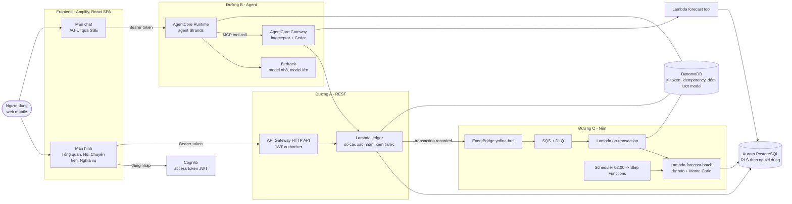

### 1.3 Ba lớp bảo vệ danh tính (áp dụng cho mọi luồng có dữ liệu người dùng)

1. **JWT**: Runtime và HTTP API chỉ nhận access token Cognito hợp lệ.
2. **Interceptor của Gateway** ghi đè `user_id` bằng `sub` trong token. Agent không tự điền được `user_id` của người khác.
3. **Cedar** kiểm `user_id == principal.id` và hạn mức số tiền; **Aurora RLS** lọc theo người dùng ở tầng DB.

## 2. Danh mục luồng

| Mã | Luồng | Đường | Trạng thái | FR |
|---|---|---|---|---|
| L01 | Đăng nhập, mở phiên, làm nóng agent | A, B | Đang chạy | — |
| L02 | Onboarding tài khoản trắng | A | Đang chạy; 26/11 kiểm trên app với tài khoản tạm: 3 hũ mặc định 42/33/25, kê khai trọ và điện ra đề xuất 36/39/25 | FR1 |
| L03 | Xem Tổng quan và Chi tiết hũ (đọc, độ tươi dự báo) | A | Đang chạy | FR1, FR3 |
| L04 | **Ghi từ màn hình: xem trước → xác nhận → thực hiện** | A | Đang chạy | FR1, FR12 |
| L05 | Một lượt chat (router → tool → khối UI → câu trả lời) | B | Đang chạy | FR3, FR12 |
| L06 | **Agent đề nghị chuyển hũ, người dùng duyệt** | B → A | Đang chạy | FR12 |
| L07 | Lương về và chia lương | A | Đang chạy | FR1 |
| L08 | Mua bằng trả sau, sinh nghĩa vụ | A | Đang chạy | FR4 |
| L09 | Tính lại dự báo sau giao dịch (sự kiện) | C | Đang chạy | FR3 |
| L10 | Batch đêm | C | Đang chạy: dự báo, hồ sơ hành vi, điểm gãy và sinh lại lộ trình, bản tin | FR3, FR8, FR10, FR13 |
| L11 | Suy giảm khi AI lỗi hoặc chạm trần | B | Đang chạy | NFR-15 |
| L12 | Đặt lại dữ liệu demo | A | Đang chạy | — |
| L13 | Hỏi "nếu thì" (harness đầy đủ, có Verifier) | B | Đang chạy (phase 3, đóng 23/11) | FR5 |
| L14 | Kiểm tra trước khi quẹt | A, B | Đang chạy (phase 3); dải "sát" hẹp (C-02) | FR6 |
| L15 | Phân hũ tự động và hỏi gộp | C | Đang chạy (phase 4, đóng 24/11) | FR2 |
| L16 | Sinh và sinh lại lộ trình | B, C | Đang chạy (phase 4); lập được trong chat | FR8 |
| L17 | Nạp ảnh và CSV | A, C | Đã deploy (phase 5, chưa đóng); có quy đổi ngoại tệ | FR9 |
| L18 | Nhắc chủ động và bản tin | C | Đã deploy (phase 5, chưa đóng) | FR13 |
| L19 | **Chia tiền dư theo thứ tự ưu tiên, trích quỹ dồn, theo dõi hũ đệm** | A, C | Một phần 26/11: thứ tự bù khi đề xuất tỷ lệ (BR-65), khoản Quỹ dồn tính một lần khi kê khai (BR-66), bộ tối ưu giữ phần chia của hũ đệm chưa tới đích tự tính (BR-64 một phần); hiện đích và khóa mềm hũ đệm (BR-64), cổng hũ dài hạn (BR-68), mốc Quỹ dồn hoãn; giữ phần chia Quỹ dồn có khoản sắp cần: issue #44 | FR3, FR7, FR8 |
| L20 | **Gợi ý chuyển giai đoạn sống** | C → A | Hoãn 26/11 (BR-70, BR-71) | FR8 |

## 3. Các luồng đang chạy

### L01 — Đăng nhập, mở phiên, làm nóng

1. Người dùng đăng nhập Cognito (tự đăng ký đã tắt; dùng tài khoản demo) và nhận access token.
2. Frontend gọi `GET /overview` để dựng Tổng quan (xem L03).
3. Khi mở màn chat, frontend tạo `conversation_id` (UUID, dùng làm session id của Runtime) và gửi một lượt **làm nóng** (`forwardedProps.warmup`). Lượt này không gọi model hay tool, chỉ để microVM khởi động trước, vì phiên lạnh mất khoảng 2 giây tới event đầu, còn phiên ấm khoảng 0,3 giây.
4. Runtime V2 **ghim phiên theo người dùng**: người khác dùng session id này sẽ bị từ chối (403). Hai request cùng phiên chạy song song bị từ chối (409).

### L02 — Onboarding tài khoản trắng

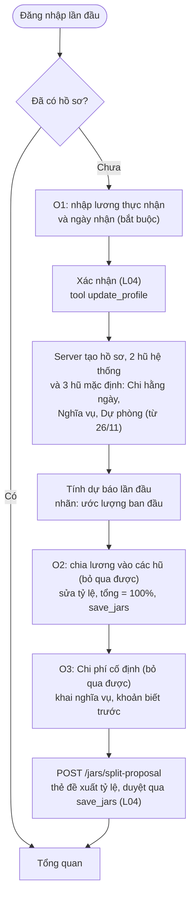

- Quy tắc: BR-01 (chỉ hai trường bắt buộc), BR-04, BR-05, BR-29, BR-78 (tỷ lệ Nghĩa vụ theo số đã khai). Bỏ qua O3 thì giữ 42/33/25 và thẻ hũ ghi "chưa có số khai". Câu hỏi giai đoạn sống (BR-70) **hoãn 26/11**. Bộ 7 hũ cũ chỉ còn là hũ tự thêm (cuối [B2a](02-business-rules.md#b2a-cơ-cấu-hũ-theo-mục-đích-và-giai-đoạn-sống-đề-xuất-2411)).
- Onboarding cũng là một thao tác ghi, nên vẫn đi qua xác nhận bằng token.

### L03 — Xem màn hình (đọc) và độ tươi của dự báo

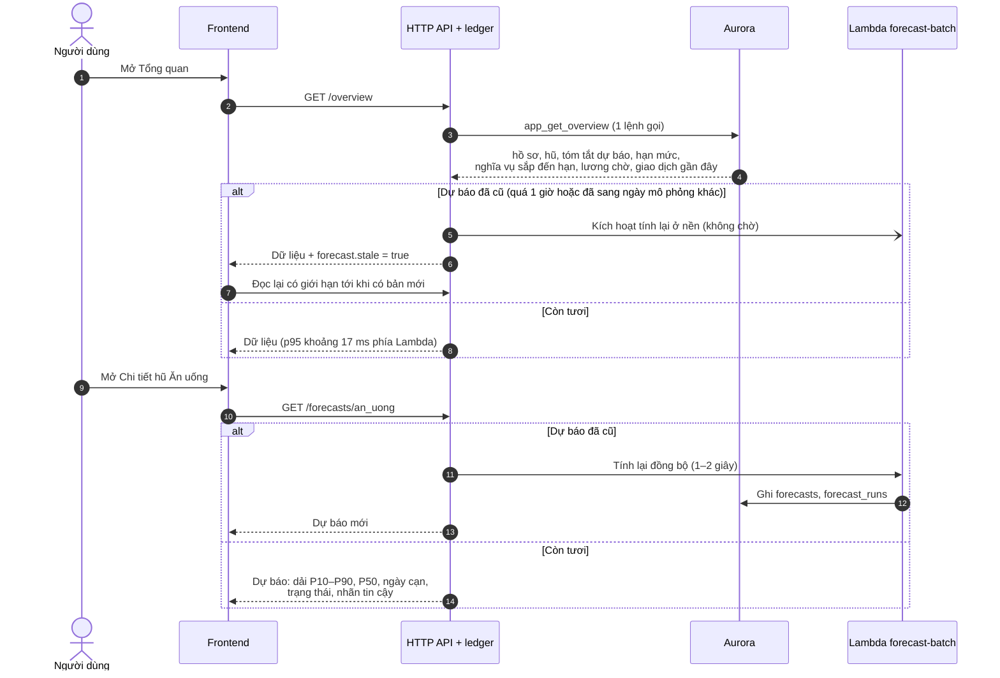

- Vì sao hai màn xử lý khác nhau: Tổng quan phải nhanh nên chỉ kích hoạt tính ở nền; Chi tiết hũ chỉ xem một hũ, nên chờ 1–2 giây để có số mới là chấp nhận được.
- **Ngày nghiệp vụ** luôn là ngày mô phỏng của tài khoản (`app_today`, ADR-0003), không phải ngày thật.

### L04 — Ghi từ màn hình: xem trước → xác nhận → thực hiện (luồng lõi)

Mọi thao tác làm đổi số dư hoặc hồ sơ đều đi qua luồng này: chi tiêu, chuyển tiền, chuyển hũ, mua trả sau, chia lương, sửa hồ sơ, sửa hũ, khai nghĩa vụ, gán hũ.

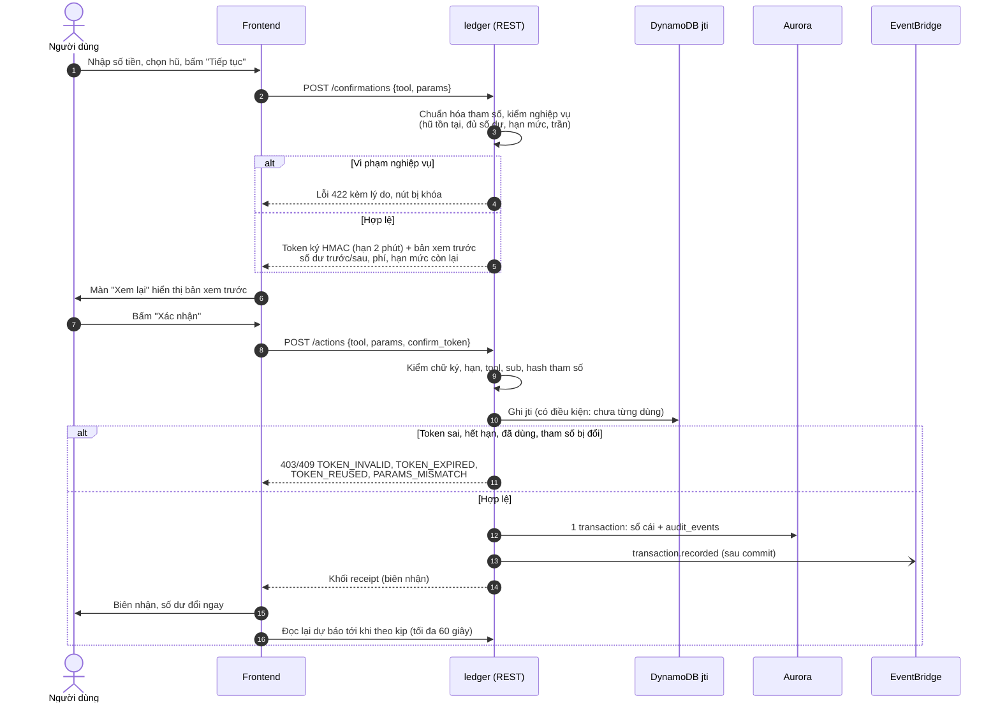

Điểm then chốt:
- **Token gắn chặt với đúng tham số đã hiển thị.** Đổi một đồng sau khi xem trước thì hash lệch và bị từ chối (`PARAMS_MISMATCH`).
- **Token chỉ dùng được một lần**, vì `jti` được ghi có điều kiện vào DynamoDB.
- **Bản xem trước do server tính.** Frontend không tự tính phí hay số dư (BR-47).
- **Không có AI trên đường ghi.**

### L05 — Một lượt chat

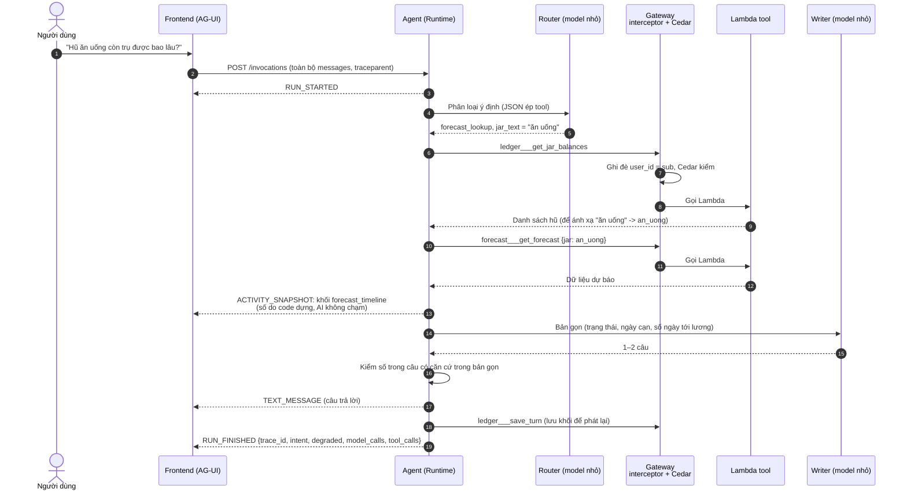

**Các ý định router hiện hỗ trợ:**

| Ý định | Tool gọi | Khối UI | Lượt model tối đa |
|---|---|---|---|
| `balance_lookup` | `get_jar_balances` | `jar_summary` | 2 |
| `transactions_lookup` | `get_jar_balances` + `query_transactions` | danh sách giao dịch | 2 |
| `forecast_lookup` | `get_jar_balances` + `get_forecast` | `forecast_timeline` | 2 |
| `move_between_jars` | `get_jar_balances` + `move_between_jars` **không token** | `confirm` (xem L06) | 2 |
| `out_of_scope` | không | `notice` + câu nói rõ giới hạn | 1 |
| `chitchat` | không | câu trả lời | 1 |

**Giới hạn mỗi lượt:** 60 giây, 4 lượt gọi model, 4 tool call. Khối UI luôn đến **trước** văn bản.

### L06 — Agent đề nghị, người dùng duyệt (human-in-the-loop)

Đây là luồng thể hiện rõ nhất cơ chế **con người duyệt trước khi hành động** (xem [mục 6](#6-cơ-chế-vận-hành-có-phải-human-in-the-loop-không)).

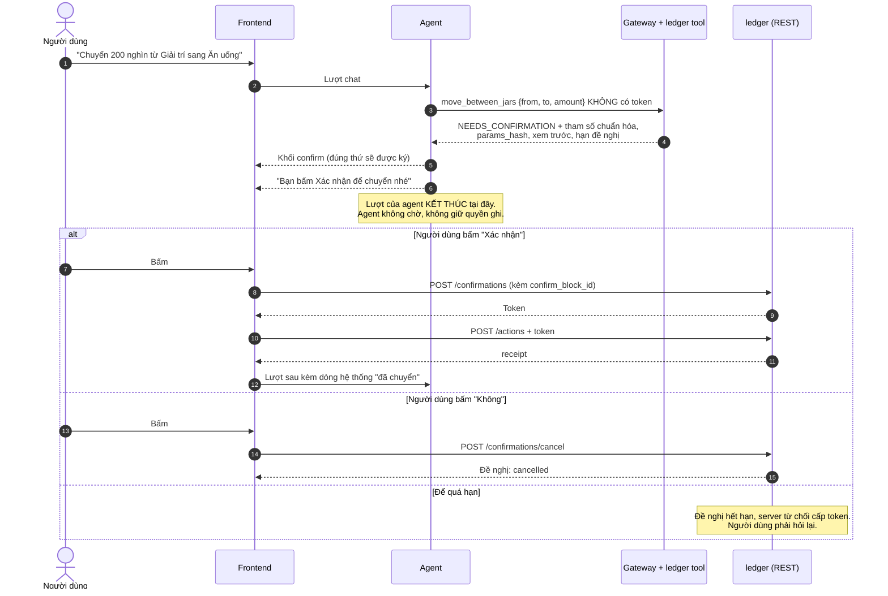

**Vòng đời của một đề nghị:**

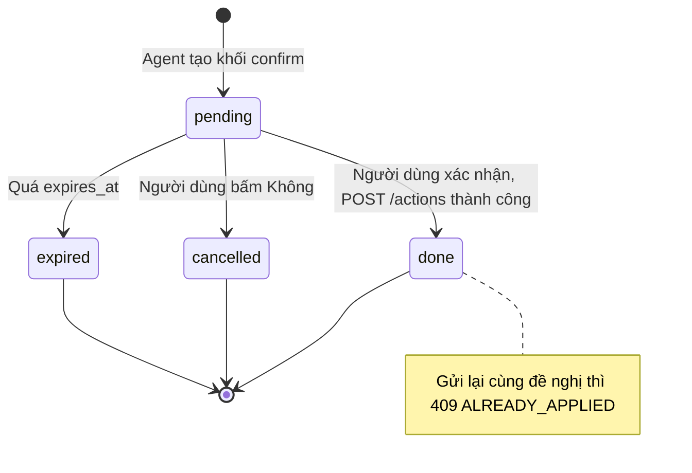

### L07 — Lương về và chia lương

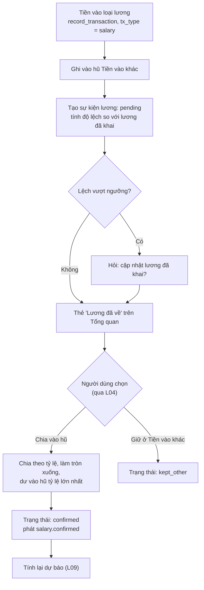

- Quy tắc: BR-10 đến BR-13. Tiền vào không phải lương chỉ nằm ở Tiền vào khác và **không tính là thu nhập**.
- *Đề xuất 24/11:* chia lương vẫn theo tỷ lệ (BR-11). Khi có tiền dư ngoài tỷ lệ (lương cao hơn khai, hũ chi theo kỳ còn thừa cuối kỳ), phần dư đi theo thứ tự BR-65, xem L19.

### L08 — Mua bằng trả sau, sinh nghĩa vụ

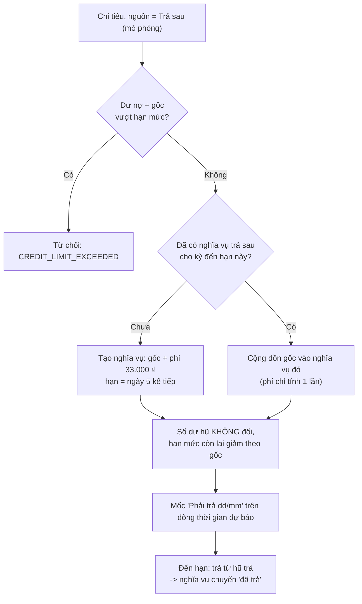

- Quy tắc: BR-22 đến BR-26. Bản xem trước ở bước "Xem lại" hiện "Phải trả ngày dd/mm: trước → sau" và "Hạn mức còn lại: trước → sau".
- Hũ trả (26/11, issue #39, `resolve_obligation_pay_jar`): hũ đã lưu, hũ người dùng chọn, hũ Nghĩa vụ, rồi hũ `obligation` đầu tiên. Ví không có hũ nào như vậy thì phải chọn hũ trả trước khi mua (agent và màn chuyển tiền hỏi; C-07). Ví demo của `minh` dùng ngày đến hạn 5 như mọi ví; khoản đến hạn đúng ngày lương tính là trước lương, trả bằng số dư trước khi lương về (BR-22, chốt 26/11).

### L09 — Tính lại dự báo sau giao dịch (sự kiện)

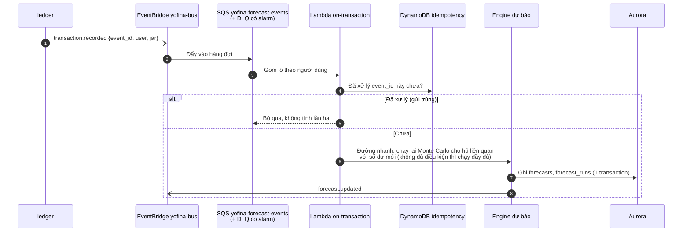

- Số đo: giao dịch 200.000 ₫ thì Chi tiết hũ có dự báo mới sau khoảng **3 giây** (mục tiêu dưới 60 giây).
- Lỗi xử lý thì vào DLQ và bật alarm.

### L10 — Batch đêm

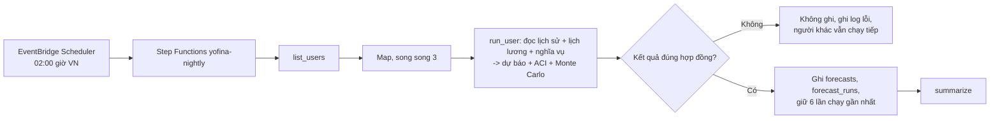

- Hiện batch chỉ làm dự báo. Phase 4–5 thêm vào cùng batch: điểm chống chịu, hồ sơ hành vi, phát hiện điểm gãy và sinh lại lộ trình, cổng nhắc và bản tin.
- Số đo: 6 tài khoản, khoảng 4 giây mỗi lần chạy.

### L11 — Suy giảm khi AI lỗi hoặc chạm trần

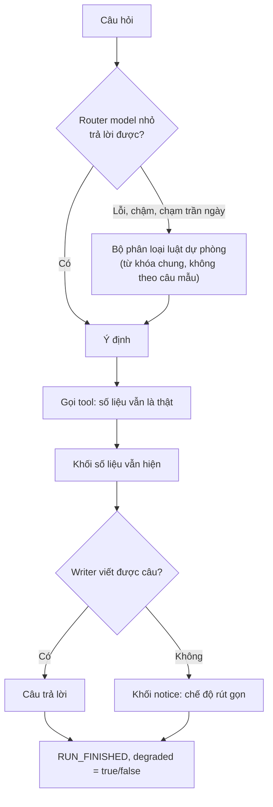

- Nguyên tắc: **AI có thể vắng, nhưng số không bao giờ sai hay biến mất**. Model đi theo chuỗi dự phòng khi bị giới hạn tốc độ hoặc từ chối truy cập. Chạm trần ngày thì không rơi sang model khác mà rơi về thẻ số liệu tất định.

### L12 — Đặt lại dữ liệu demo

1. Người dùng vào Hồ sơ và bấm "Đặt lại dữ liệu", gọi `POST /demo/reset`.
2. Server chỉ xóa dữ liệu của **chính người gọi**, rồi sinh lại persona theo seed, nạp vào bộ hũ demo (từ 26/11: Chi hằng ngày, Nghĩa vụ, Dự phòng cộng hũ tự thêm Ăn uống, Đi lại, Giải trí, Du lịch, Đầu tư; `minh` 8 hũ), không vào bộ mặc định của onboarding (BR-62).
3. Ngày mô phỏng quay về ngày neo 21/11/2026; dự báo được tính đồng bộ ngay.
4. Mất khoảng 6 giây. Trả `forecast_ready: true` để mở app là có số.

## 4. Các luồng phase 3–5 (viết lúc còn là thiết kế; nay đã chạy, xem trạng thái ở mục 2)

### L13 — Hỏi "nếu thì" (harness đầy đủ)

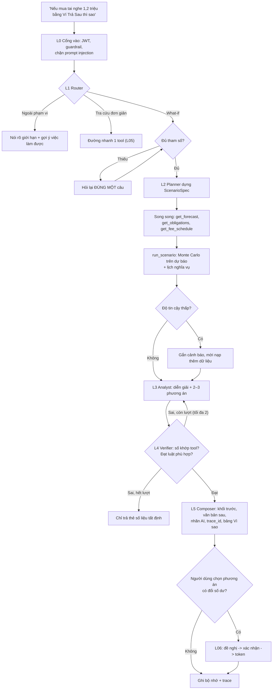

Giới hạn: mỗi lượt tối đa 4 lượt gọi model (1 router + 2 planner + 1 diễn giải); trọn câu p95 dưới 8 giây.

### L14 — Kiểm tra trước khi quẹt

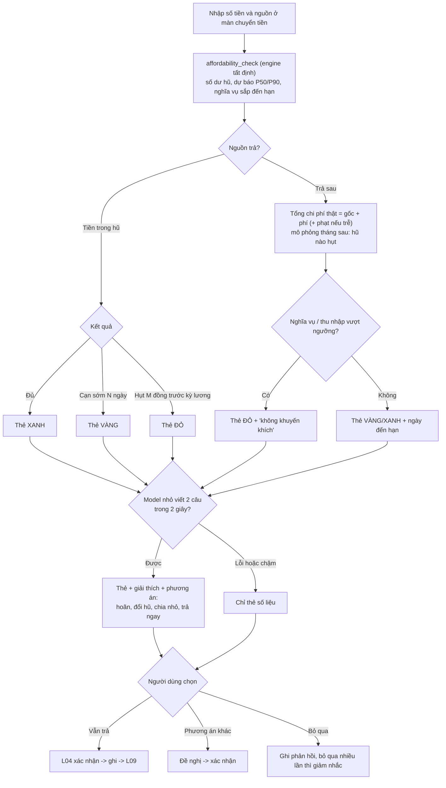

### L15 — Phân hũ tự động và hỏi gộp

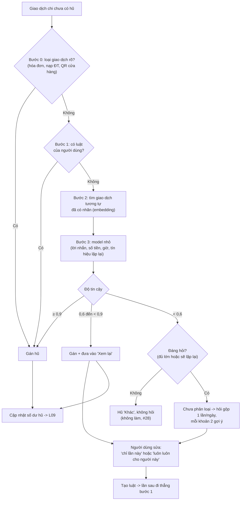

- Bước 0 chọn hũ theo `yofina_core.wallet.transaction_jar` (26/11): ví có hũ riêng khớp loại giao dịch thì hũ riêng nhận (ví demo: Ăn uống, Đi lại, Giải trí, Du lịch); không có thì vào Chi hằng ngày (khoản chi) hoặc Nghĩa vụ (hóa đơn, thuê bao). Bốn loại `bnpl_purchase`, `transfer_person`, `qr_other`, `other_expense` không có hũ mặc định nên đi tiếp sang bước 1–3 trên mọi ví ([đo ví 3 hũ](../research/2026-11-26-do-vi-ba-hu.md)).
- Nhánh hũ "Khác": **không làm** (chủ dự án chốt 26/11, issue #28 đóng; BR-18). Khoản nhỏ một lần đi theo ngưỡng tin cậy như mọi khoản.

### L16 — Sinh và sinh lại lộ trình

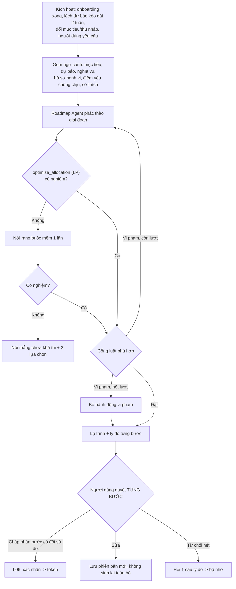

Khoản chi lớn đơn lẻ (ngoại lai) **không** kích hoạt sinh lại lộ trình; chỉ điều chỉnh dự báo của kỳ này.

### L17 — Nạp ảnh và CSV

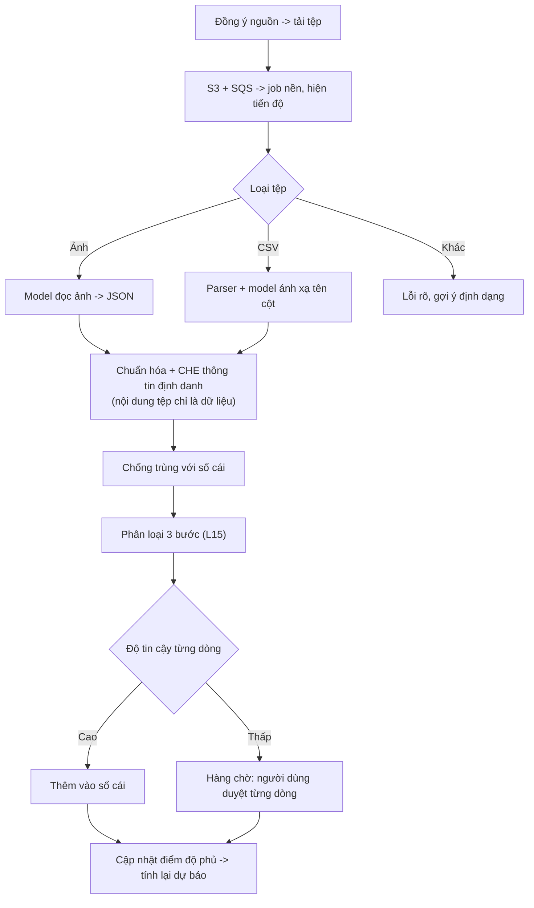

### L18 — Nhắc chủ động

- **Đang chạy**: thẻ chủ động trên Tổng quan chỉ nêu **một việc** (hũ rủi ro nhất, nghĩa vụ đến hạn trong 3 ngày, lương chờ xác nhận), có "Hỏi vì sao", "Để sau", "Ít nhắc loại này".
- **Thiết kế**: sau batch đêm, cổng nhắc kiểm hai điều: giá trị có đủ lớn không, và hôm nay đã nhắc chưa. Nếu qua cả hai thì gửi một bản tin, nếu không thì im lặng. Tối đa một lần mỗi ngày (BR-60).

### L19 — Chia tiền dư, trích quỹ dồn, theo dõi hũ đệm (đề xuất 24/11)

**Trạng thái 26/11:** một phần, xem dòng L19 ở mục 2 và BR-64 đến BR-68 ở [02 B2a](02-business-rules.md#b2a-cơ-cấu-hũ-theo-mục-đích-và-giai-đoạn-sống-đề-xuất-2411). Sơ đồ dưới là thiết kế đầy đủ.

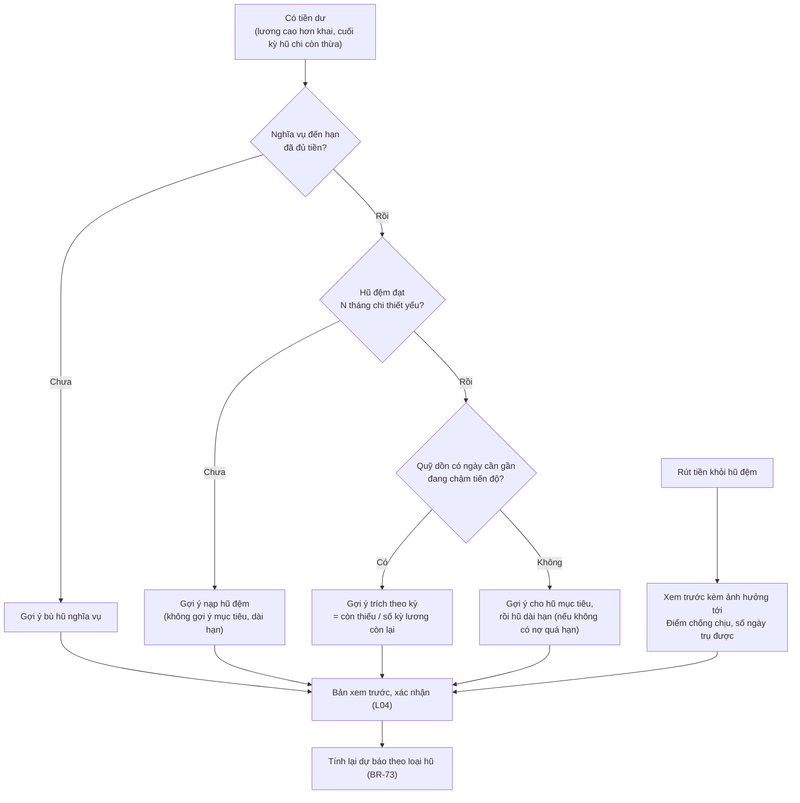

- Quy tắc: BR-63 đến BR-68, BR-73. Mọi bước chỉ là **gợi ý**; tiền chỉ di chuyển sau xác nhận (BC-04, BR-45).
- Ngày cần của quỹ dồn hiện thành mốc trên dòng thời gian dự báo, giống nghĩa vụ (BR-66).
- Hũ đệm và dài hạn **không tính là tiền có thể chi** trong L14 (BR-68).

### L20 — Gợi ý chuyển giai đoạn sống (đề xuất 24/11)

**Trạng thái 26/11:** hoãn cùng BR-70, BR-71 (mọi tài khoản mới nhận cùng 3 hũ mặc định).

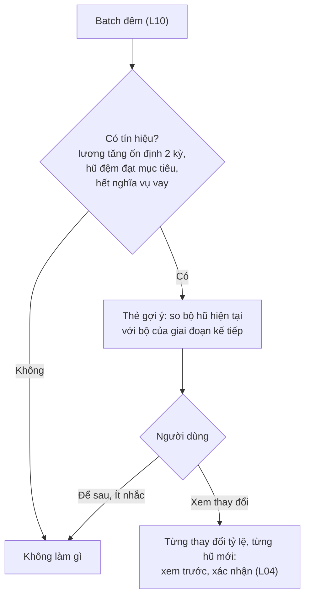

- Quy tắc: BR-70, BR-71, BR-60 (tối đa một nhắc mỗi ngày). Hệ thống **không bao giờ tự đổi giai đoạn**.

## 5. Máy trạng thái của các đối tượng chính

**Sự kiện lương:**

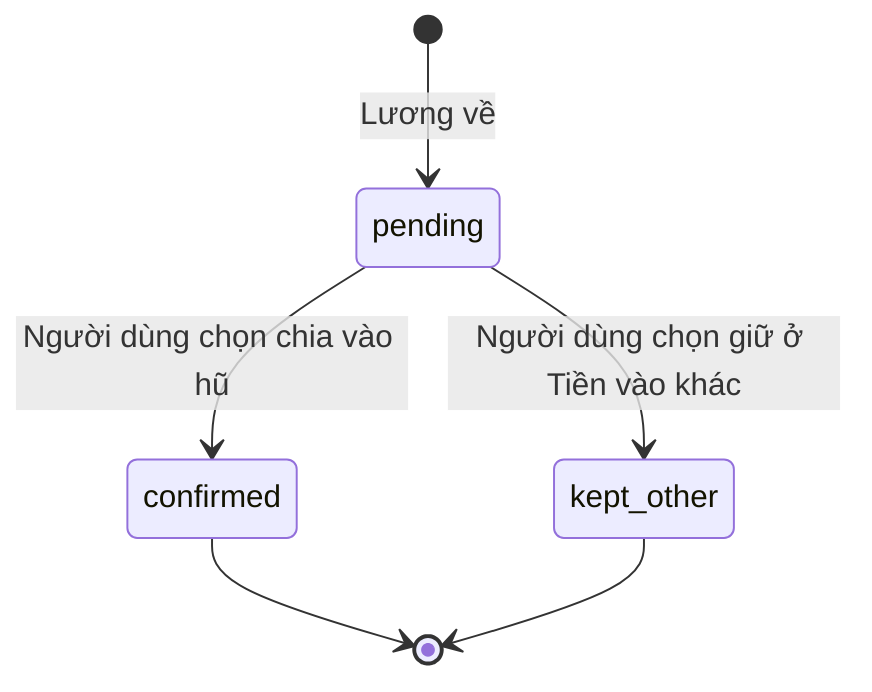

**Nghĩa vụ:**

```mermaid
stateDiagram-v2
    [*] --> active: Người dùng khai, hoặc mua trả sau
    active --> active: Mua trả sau thêm cùng kỳ (cộng dồn)
    active --> active: Trả khoản lặp (dời hạn sang kỳ sau)
    active --> paid: Trả khoản một lần
    active --> deleted: Người dùng xóa (qua xác nhận)
    paid --> [*]
    deleted --> [*]
```

**Phân loại giao dịch (thiết kế, phase 4):**

```mermaid
stateDiagram-v2
    [*] --> chua_phan_loai: Chi chưa rõ hũ
    [*] --> da_gan: Tự gán (tin cậy cao) hoặc người dùng chọn hũ lúc trả
    chua_phan_loai --> da_gan: Người dùng trả lời hỏi gộp
    [*] --> xem_lai: Tin cậy trung bình
    xem_lai --> da_gan: Người dùng giữ nguyên hoặc sửa
    da_gan --> da_gan: Người dùng sửa -> tạo luật
```

## 6. Cơ chế vận hành có phải human-in-the-loop không?

**Trả lời ngắn: có, nhưng không phải ở mọi chỗ.** Yofina dùng **ba mức tham gia của con người** tùy theo rủi ro của từng quyết định. Đây là thiết kế có chủ đích, không phải "mọi thứ đều hỏi người dùng".

| Mức | Nghĩa | Ở đâu trong Yofina |
|---|---|---|
| **Human-in-the-loop** (con người duyệt **trước** khi hệ thống hành động) | Hệ thống dừng lại; không có xác nhận thì không làm | **Mọi thay đổi số dư và hồ sơ** (L04, L06): chuyển hũ, chi tiêu, trả sau, chia lương, sửa hồ sơ. Duyệt **từng bước** lộ trình (L16). Dòng nạp tin cậy thấp (L17). Khoản phân loại tin cậy thấp đáng hỏi (L15) |
| **Human-on-the-loop** (hệ thống tự làm, con người giám sát và sửa được) | Làm trước, người dùng xem lại và sửa sau | Phân loại tin cậy trung bình: tự gán + danh sách "Xem lại" (L15). Thẻ chủ động và bản tin, có "Ít nhắc loại này" (L18). Lộ trình tự sinh lại nhưng chờ duyệt (L16). Đội `ops` xem trace (FR15) |
| **Human-out-of-the-loop** (tự động hoàn toàn) | Không cần con người, vì không đổi tiền và có thể kiểm lại | Dự báo đêm và theo sự kiện (L09, L10); router chọn ý định; phân loại tin cậy cao; Verifier kiểm số và luật; chuyển sang chế độ suy giảm (L11) |

### 6.1 Khác gì với cách làm human-in-the-loop thông thường

Cách phổ biến trong framework agent là **interrupt/resume**: agent dừng giữa lượt, chờ người duyệt, rồi chạy tiếp. Phiên agent phải giữ nguyên trong lúc chờ. Yofina **không làm vậy** (ADR-0002), mà tách việc duyệt ra khỏi agent:

| | Interrupt/resume thông thường | Cách của Yofina |
|---|---|---|
| Agent khi chờ duyệt | Treo giữa lượt, giữ phiên | **Kết thúc lượt** ngay sau khi đưa đề nghị |
| Ai thực hiện việc ghi | Agent, sau khi được duyệt | **Server** (REST `ledger`), sau khi kiểm token |
| Bằng chứng người dùng đã duyệt | Cờ `approved` gửi lại cho agent | **Token ký HMAC dùng một lần**, gắn với người dùng, đúng tham số và hạn 2 phút |
| AI có thể tự duyệt không | Có rủi ro (prompt injection điền cờ) | **Không**: AI không bao giờ cầm token, và không nằm trên đường ghi |
| Đã kiểm | — | 13 ca tấn công bị chặn (bịa token, dùng lại, đổi tham số, token người khác, hết hạn…) |

Một câu để nói với giám khảo: **"AI đề xuất, con người quyết định, máy chủ thực thi, và AI không thể tự duyệt cho chính mình."**

### 6.2 Vòng phản hồi từ con người (human feedback loop)

Ngoài việc duyệt, người dùng còn **dạy** hệ thống qua các vòng sau:
- Sửa phân loại tạo thành luật ("luôn luôn cho người này"), lần sau tự đúng (L15).
- Bấm "Ít nhắc loại này" hoặc bỏ qua cảnh báo nhiều lần làm giảm tần suất nhắc (L14, L18).
- Từ chối lộ trình: hệ thống hỏi một câu lý do và ghi vào bộ nhớ (L16).
- Sở thích nói trong chat được ghi vào bộ nhớ dài hạn (FR10).

## 7. Gợi ý bộ diagram nên vẽ

| # | Diagram | Loại | Lấy từ | Dùng cho |
|---|---|---|---|---|
| 1 | Kiến trúc tổng thể 3 đường vào | Context / container (C4 mức 1–2) | Mục 1.2 | Slide kiến trúc |
| 2 | Xác nhận trước khi ghi | Sequence | L04 + L06 | Slide "an toàn", giải thích HITL |
| 3 | Một lượt chat, khối số trước văn bản | Sequence | L05 | Slide "AI không bịa số" |
| 4 | Ba mức tham gia của con người | Bảng hoặc phổ 3 mức | Mục 6 | Slide HITL |
| 5 | Ba nhịp chạy: đồng bộ, sự kiện, đêm | Swimlane | L05, L09, L10 | Slide vận hành |
| 6 | Hỏi "nếu thì" với Verifier | Flowchart | L13 | Slide harness |
| 7 | Kiểm tra trước khi quẹt | Flowchart | L14 | Slide tính năng F3 |
| 8 | Phân hũ 4 bước + 3 mức tin cậy | Flowchart | L15 | Slide phân loại |
| 9 | Vòng đời đề nghị, lương, nghĩa vụ | State | Mục 5 | Tài liệu kỹ thuật |
| 10 | Hành trình người dùng theo 6 cảnh demo | User journey | [demo-script](../plan/demo-script.md) | Video, slide mở đầu |
