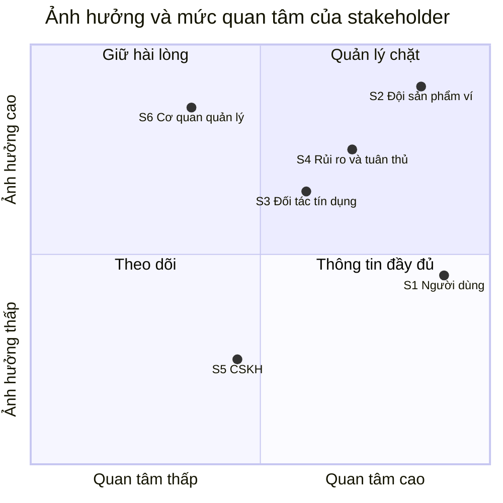
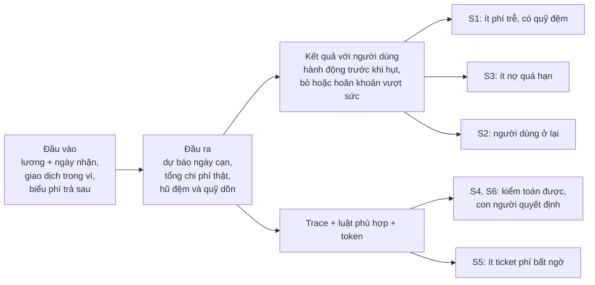

# Phân tích tác động lên các bên liên quan

> Bản nháp để nhóm duyệt, viết ngày 24/11/2026. Dùng đúng **6 nhóm stakeholder đã chốt** ở proposal §3 ([proposal-summary](../proposal/proposal-summary.md#3-stakeholders-3)). Ngân hàng và công ty bảo hiểm (thêm ở [06 mục 3](06-mo-hinh-kinh-doanh.md#3-giá-trị-tạo-ra-và-bên-hưởng-lợi)) được gộp vào nhóm đối tác tài chính.
> Mỗi tác động đều có: tính năng gây ra nó, cách đo (KPI ở [08](08-kpi-kinh-doanh.md), NFR ở [04](04-non-functional-requirements.md)), và cách xử lý nếu là tác động tiêu cực. Tác động **tiêu cực được ghi ngang hàng với tích cực**: một sản phẩm chỉ có lợi cho mọi bên thì không đáng tin.

## 1. Sáu nhóm stakeholder

| Mã | Stakeholder | Vai trò (proposal §3) | Ví dụ cụ thể |
|---|---|---|---|
| S1 | **Người dùng cuối 18–30 tuổi có dùng trả sau** | Người dùng chính | Persona Minh 22 tuổi, Lan sinh viên; định nghĩa ở BC-13 |
| S2 | **Đội sản phẩm quản lý tài chính của ví** | Chủ sản phẩm | Đội Quản Lý Chi Tiêu của MoMo |
| S3 | **Đội tín dụng và đối tác tài chính** | Hưởng lợi gián tiếp | Bên cấp Ví Trả Sau (MoMo công bố TPBank, MBV, VCBNeo); ngân hàng nhận tiền gửi; công ty bảo hiểm |
| S4 | **Đội rủi ro và tuân thủ** | Giám sát | Rủi ro tín dụng, pháp chế, an toàn dữ liệu của ví và đối tác |
| S5 | **Đội chăm sóc khách hàng** | Hưởng lợi gián tiếp | Tổng đài, chat hỗ trợ của ví |
| S6 | **Cơ quan quản lý** | Ràng buộc | NHNN (ví điện tử, tín dụng); các cơ quan thi hành Luật Bảo vệ dữ liệu cá nhân và Luật Trí tuệ nhân tạo |

## 2. Bản đồ ảnh hưởng và mức quan tâm

| Nhóm | Stakeholder | Cách làm việc |
|---|---|---|
| **Quản lý chặt** (ảnh hưởng cao, quan tâm cao) | S2, S4, S3 | Cùng đặt KPI từ đầu (file 08); cho xem trace và luật ngay trong pilot; ký thỏa thuận KPI rào chắn (K4-R) |
| **Giữ hài lòng** (ảnh hưởng cao, quan tâm thấp hơn) | S6 | Thiết kế tuân thủ ngay từ đầu (xác nhận của con người, gắn nhãn AI, che dữ liệu); chuẩn bị sẵn hồ sơ giải trình |
| **Thông tin đầy đủ** (quan tâm cao, ảnh hưởng thấp hơn) | S1 | Phỏng vấn và dùng thử; tôn trọng quyền từ chối nhắc, xóa dữ liệu |
| **Theo dõi** | S5 | Kịch bản trả lời cho các câu hỏi mới; theo dõi số ticket |

## 3. Tác động lên từng stakeholder

### S1. Người dùng 18–30 tuổi có dùng trả sau

| | Tác động | Tính năng gây ra | Cách đo |
|---|---|---|---|
| ➕ | **Biết trước lúc thiếu tiền**: hũ nào cạn ngày nào, còn bao nhiêu ngày tới lương | F1 dự báo (BR-28) | K5: cảnh báo trước ≥ 7 ngày, đúng ≥ 70% |
| ➕ | **Không bị phí bất ngờ**: thấy tổng phải trả gồm phí trước khi mua. Cùng món hàng 1,2 triệu, tổng phải trả dao động 0–13,5% tùy ví và số ngày trễ ([09 mục 4.4](09-phan-tich-doi-thu.md#44-phí-trả-sau-mỗi-ví-tính-một-kiểu-không-ai-cộng-sẵn-trước-khi-mua)) | F3 kiểm tra trước khi quẹt; xem trước gồm phí (BR-47) | K4: phí trễ hạn giảm ≥ 10%; K4-R: tổng phí không tăng |
| ➕ | **Có quỹ đệm**: biến cú sốc biết trước (Tết, học phí) thành khoản trích đều | Hũ đệm, hũ quỹ dồn (BR-64, BR-66) | K10: tỷ lệ người dùng có hũ đệm ≥ 1 tháng chi thiết yếu |
| ➕ | **Ít phải nhập tay**, chỉ bị hỏi khi đáng hỏi | Phân hũ tự động (BR-16 đến 19) | NFR-14: dưới 10% giao dịch phải hỏi |
| ➕ | **Kiểm soát**: không gì đổi số dư nếu chưa bấm xác nhận | Token dùng một lần (BR-45) | NFR-22: 0 lượt ghi không xác nhận |
| ➖ | **Dự báo sai gây lo lắng hoặc chủ quan**: báo hụt mà không hụt, hoặc ngược lại | F1 | Tỷ lệ cảnh báo sai trong K5. **Xử lý:** nhãn tin cậy, chỉ hiện % khi backtest đạt (BR-30, 31), câu chữ "dựa trên số đã khai" |
| ➖ | **Bị làm phiền** bởi nhắc nhở | F7, thẻ chủ động | Tỷ lệ bấm "Ít nhắc loại này". **Xử lý:** tối đa 1 nhắc/ngày (BR-60) |
| ➖ | **Trả nợ này, thiếu tiền chỗ khác**: nhắc trả nợ làm phí thấu chi tăng 9% ở nhóm hay thấu chi (Medina 2021) | Nhắc hạn | K4-R. **Xử lý:** dự báo nhìn mọi hũ cùng lúc; gợi ý không được làm hụt hũ khác |
| ➖ | **Lo ngại quyền riêng tư** | Toàn sản phẩm | NFR-26 đến 29. **Xử lý:** che dữ liệu định danh trước khi đưa vào LLM, xóa theo yêu cầu, đồng ý theo từng nguồn (BC-06) |

### S2. Đội sản phẩm quản lý tài chính của ví

| | Tác động | Tính năng gây ra | Cách đo |
|---|---|---|---|
| ➕ | **Tính năng khác biệt**: phần "nhìn trước" mà chưa đối thủ nào công bố ([09](09-phan-tich-doi-thu.md)) | F1 đến F5 | K1: 15% người dùng trả sau dùng sau 12 tháng |
| ➕ | **Người dùng quay lại theo lịch tự nhiên** (lương, hạn trả sau, dự báo đổi sau mỗi giao dịch) | F1, thẻ chủ động | K3: D30 ≥ 15% (trung vị ngành 7–11,6%) |
| ➕ | **Nâng cấp phần đã có thay vì thay thế**: dùng lại phân loại và thanh toán của ví | Kiến trúc lớp kế hoạch | Số tính năng hiện có được tái sử dụng |
| ➕ | **Doanh thu mới** từ gói nâng cao | Gói Thông minh, Chuyên sâu | K8: 3% chuyển sang trả phí |
| ➖ | **Chi phí tích hợp và vận hành**, gồm chi phí AI tăng theo lượt dùng | Toàn sản phẩm | K6 (biên ≥ 65%), K7 (AI ≤ 15% doanh thu). **Xử lý:** dự báo chạy batch, trần lượt gọi (NFR-35) |
| ➖ | **Trùng lặp hoặc gây rối** với Quản Lý Chi Tiêu và Phân Bổ Lương hiện có | B2a cơ cấu hũ | Nghiên cứu người dùng trong pilot. **Xử lý:** định vị "ngân sách nhìn lại, Yofina nhìn trước" ([09 mục 4.2](09-phan-tich-doi-thu.md#42-cảnh-báo-ngân-sách-khác-dự-báo-ngày-cạn)) |
| ➖ | **Áp lực mâu thuẫn**: muốn tăng tương tác nhưng sản phẩm giới hạn nhắc | BR-60 | Theo dõi song song giữ chân và tỷ lệ "Ít nhắc". **Xử lý:** thống nhất chỉ số Bắc Đẩu là "số người tránh được hụt", không phải số lần mở app |

### S3. Đội tín dụng và đối tác tài chính

| | Tác động | Tính năng gây ra | Cách đo |
|---|---|---|---|
| ➕ | **Ít nợ quá hạn, ít phải thu hồi**: SMS nhắc hạn trên trả sau giảm 21–24% số khách bị phí trễ (AFM 2024, tuổi trung bình 29), tin nhắn hành vi giảm 4% khả năng trễ (Colombia 2026) | Nghĩa vụ trong dự báo; F3 | K4; R4 phí theo kết quả |
| ➕ | **Rủi ro uy tín thấp hơn**: người dùng biết tổng chi phí trước khi mua, ít "bẫy nợ" trên báo chí | F3, bảng "Vì sao" | Số bài báo hoặc khiếu nại về phí (định tính) |
| ➕ | **Ngân hàng nhận tiền gửi** từ hũ đệm và hũ dài hạn | BR-68, R7 | Số tài khoản tiết kiệm mở qua gợi ý phù hợp |
| ➖ | **Giảm thu phí chậm trả.** Phí này là nguồn thu (MoMo công bố 5,25–21% dư nợ quá hạn) | K4 | So phần phí mất đi với phần tổn thất và chi phí thu hồi giảm được trong pilot. **Xử lý:** R4 chỉ thu khi lợi ròng dương |
| ➖ | **Có thể giảm dư nợ mới**: F3 có thể khuyên "không khuyến khích" một số khoản mua | F3 (BR-37) | Dư nợ mới ở nhóm dùng Yofina so với nhóm đối chứng. **Xử lý:** chấp nhận có chủ đích. Luật phù hợp không tắt được (BR-42); chỉ chặn khoản vượt ngưỡng nghĩa vụ trên thu nhập |
| ➖ | **Phải chia sẻ biểu phí và dữ liệu dư nợ** để tính tổng chi phí thật | `fee_schedules` | **Xử lý:** chỉ cần biểu phí công khai và dư nợ của chính người dùng, không cần dữ liệu chấm điểm |

### S4. Đội rủi ro và tuân thủ

| | Tác động | Tính năng gây ra | Cách đo |
|---|---|---|---|
| ➕ | **Mọi gợi ý truy vết được**: dữ liệu đã dùng, luật đã kiểm, `trace_id` | FR11, `audit_events` | NFR-31: 100% lượt có trace |
| ➕ | **Không có thao tác ghi nào AI tự làm**: token dùng một lần, đã chặn 13 ca tấn công | BR-45 | NFR-22 |
| ➕ | **Luật phù hợp tất định, kiểm thử được**, không dựa vào lời tự nhận của model | BR-42, Verifier | NFR-33: 0 gợi ý vi phạm trong bộ đối kháng 50 câu |
| ➕ | **Bảng vận hành** xem số lần luật chặn | FR15, R6 | — |
| ➖ | **Thêm việc**: duyệt luật phù hợp, ngưỡng, biểu phí; giám sát rủi ro mô hình (dự báo sai, AI viết sai số) | Toàn sản phẩm | **Xử lý:** số chỉ đến từ engine (BR-48), kiểm số tự động (NFR-07), backtest công khai (NFR-10, 11) |
| ➖ | **Rủi ro bị coi là tư vấn tài chính hoặc đầu tư** | F2, F5 | **Xử lý:** không nêu sản phẩm cụ thể (BC-03), gắn nhãn AI (BC-05), con người quyết định (BC-04) |

### S5. Đội chăm sóc khách hàng

| | Tác động | Tính năng gây ra | Cách đo |
|---|---|---|---|
| ➕ | **Ít ticket về khoản trừ không rõ và phí bất ngờ** | Xem trước gồm phí, bảng "Vì sao" | K11; quy ra tiền ở [06 mục 4.3c](06-mo-hinh-kinh-doanh.md#43-roi) |
| ➕ | **Vai trò mới có giá trị hơn**: hỗ trợ trước hạn cho người dùng sắp hụt nghĩa vụ lớn, thay vì trả lời ticket phí | BR-77 | Tỷ lệ ca được hỗ trợ trước hạn mà không trễ hạn |
| ➕ | **Có sẵn lời giải thích** để trả lời khách: trace của lượt tư vấn | FR11 | Thời gian xử lý ticket liên quan |
| ➖ | **Loại ticket mới**: "sao app báo tôi sắp hụt", "sao xếp sai hũ" | F1, F2 phân loại | **Xử lý:** kịch bản trả lời; nút "sửa hũ" một chạm tạo luật (BR-19) |
| ➖ | **Cần đào tạo** về cách đọc dự báo và nhãn tin cậy | F1 | **Xử lý:** tài liệu ngắn và mẫu câu trả lời trước pilot |
| ➖ | **Lo bị cắt việc** nếu đối tác coi Yofina là công cụ thay người | Cách định vị | **Xử lý:** không tính cắt nhân sự vào ROI (06 mục 4.3d); giờ công giải phóng chuyển sang hỗ trợ trước hạn |

### S6. Cơ quan quản lý

| | Tác động | Tính năng gây ra | Căn cứ |
|---|---|---|---|
| ➕ | **Phù hợp hướng bảo vệ người tiêu dùng tín dụng**: tổng chi phí minh bạch trước khi mua, giảm nợ chồng nợ ở người trẻ | F3, nghĩa vụ trong dự báo | Báo chí 2026 về "văn hóa nợ" của sinh viên ([01 mục 4.2](01-boi-canh-thi-truong.md#42-mua-trước-trả-sau-và-nợ-nhỏ)); Thái Lan rà soát trả sau |
| ➕ | **Tuân thủ ngay từ thiết kế**: con người giữ quyền quyết định, gắn nhãn AI, che dữ liệu, xóa theo yêu cầu | BC-04, BC-05, BC-06 | Luật Trí tuệ nhân tạo 134/2025; Luật Bảo vệ dữ liệu cá nhân 91/2025 |
| ➖ | **Dữ liệu có thể được xử lý ngoài Việt Nam**: model qua profile `global.`, hạ tầng ở Singapore | Kiến trúc AWS | **Phải xử lý trước khi chạy dữ liệu thật**: đánh giá tác động chuyển dữ liệu ra nước ngoài theo luật; công bố (C-09); cân nhắc vùng xử lý |
| ➖ | **Chưa rõ phân loại rủi ro** của AI tư vấn tài chính cá nhân theo Luật Trí tuệ nhân tạo | F2, F5 | Đã ghi ở [01 mục 7](01-boi-canh-thi-truong.md#7-bối-cảnh-pháp-lý-đầu-vào-cho-ràng-buộc-nghiệp-vụ); cần ý kiến pháp lý trước khi thương mại hóa |

## 4. Ma trận tính năng × stakeholder

**Ký hiệu:**
- ➕ tác động tích cực chính.
- ➖ tác động tiêu cực cần xử lý.
- ± có cả hai mặt.
- · không đáng kể.

| Tính năng | S1 Người dùng | S2 Đội sản phẩm | S3 Đối tác tín dụng | S4 Rủi ro | S5 CSKH | S6 Quản lý |
|---|---|---|---|---|---|---|
| F1 Dự báo ngày cạn | ➕ | ➕ | ➕ | ± (rủi ro mô hình) | ± (ticket mới) | · |
| F2 Hỏi "nếu thì" | ➕ | ➕ | · | ± (ranh giới tư vấn) | · | ± |
| F3 Kiểm tra trước khi quẹt | ➕ | ➕ | ± (ít trễ hạn, ít dư nợ mới) | ➕ | ➕ | ➕ |
| F4 Điểm chống chịu | ➕ | ➕ | ➕ (tiền gửi) | ± (không phải điểm tín dụng) | · | ± |
| F5 Lộ trình | ➕ | ➕ | ➕ (tích lũy) | ± | · | ± |
| F6 Nạp dữ liệu | ± (tiện, nhưng lo riêng tư) | ➕ | · | ➖ (dữ liệu nhạy cảm) | · | ➖ |
| F7 Nhắc chủ động | ± | ➕ | ➕ | · | ➕ | · |
| Cơ cấu hũ mới (B2a) | ➕ | ± (trùng Phân Bổ Lương) | ➕ | · | · | · |
| Xác nhận bằng token | ➕ | · | ➕ | ➕ | ➕ | ➕ |
| Bảng "Vì sao" và trace | ➕ | ➕ | ➕ | ➕ | ➕ | ➕ |

**Nhận xét:** hai tính năng có lợi cho **mọi** stakeholder là **xác nhận bằng token** và **bảng "Vì sao"**. Đây là phần nên nhấn mạnh khi trình bày với giám khảo và đối tác. F6 (nạp dữ liệu) là tính năng có nhiều tác động tiêu cực nhất, nên việc proposal xếp nó vào mục cắt đầu tiên khi thiếu thời gian là hợp lý.

## 5. Xung đột lợi ích và cách giải quyết

| # | Xung đột | Giữa | Cách giải quyết trong sản phẩm |
|---|---|---|---|
| X1 | Bên cho vay thu phí chậm trả; người dùng muốn không bị phí | S3 và S1 | Chỉ số chính là **tổn thất ròng** của bên cho vay, không phải doanh thu phí. R4 chỉ thu khi lợi ròng dương. Luật phù hợp không tắt được (BR-42) |
| X2 | Đội sản phẩm muốn tăng tương tác; người dùng không muốn bị làm phiền | S2 và S1 | Tối đa 1 nhắc mỗi ngày (BR-60); chỉ số Bắc Đẩu là "số người tránh được hụt" |
| X3 | Bán chéo sản phẩm tài chính; người dùng chưa có quỹ đệm | S3 và S1 | Cổng phù hợp: hũ đệm đủ mới gợi ý tích lũy dài hạn (BR-65, BR-68); hiện rõ "có hoa hồng" (R7) |
| X4 | Muốn ra mắt nhanh; yêu cầu tuân thủ | S2 và S4, S6 | Tuân thủ nằm sẵn trong kiến trúc (token, trace, che dữ liệu), không phải hạng mục làm thêm sau |
| X5 | Muốn dữ liệu phong phú để dự báo tốt; quyền riêng tư | S1, S4 và S6 | Thu thập tối thiểu; chỉ lương và ngày nhận là bắt buộc (BR-01); bộ nhớ không lưu giao dịch thô (BR-59) |

## 6. Chuỗi tác động: từ đầu vào tới thay đổi

## 7. Tác động theo mốc thời gian

| Mốc | Chứng minh được gì | Cho stakeholder nào |
|---|---|---|
| **M0 Cuộc thi** | Dự báo đúng và sớm (backtest); xác nhận bằng token chặn 13 ca tấn công; trace 100% lượt; chi phí mỗi lượt | S2 (giám khảo của MoMo), S4, S6 |
| **M1 Pilot 8 tuần** | Phí trễ hạn giảm và tổng phí không tăng (K4, K4-R); giữ chân W4, W8; ticket CSKH về phí | S1, S3, S5 |
| **M2 Năm đầu** | Độ phủ, doanh thu, ROI đối tác; tiền gửi từ hũ đệm và dài hạn | S2, S3 |

## 8. Việc cần nhóm quyết

| ID | Câu hỏi | Gợi ý |
|---|---|---|
| F-01 | Có thêm chỉ số "tỷ lệ người dùng có hũ đệm đạt mục tiêu" vào bộ KPI không | Nên thêm; đo trực tiếp tác động lên S1 và F4. **Đã thêm dạng đề xuất là K10** ([08 mục 3.9](08-kpi-kinh-doanh.md#39-k10-hũ-đệm-đạt-ít-nhất-1-tháng-chi-thiết-yếu-đề-xuất-2411)), chờ nhóm duyệt |
| F-02 | Đưa xung đột X1 (phí chậm trả của bên cho vay) lên slide không | Nên. Nói thẳng xung đột và cách giải quyết làm tăng độ tin cậy với giám khảo |
| F-03 | Thứ tự ưu tiên làm việc với stakeholder trong pilot | S2 → S4 → S3 → S5; chuẩn bị hồ sơ cho S6 trước khi dùng dữ liệu thật |
